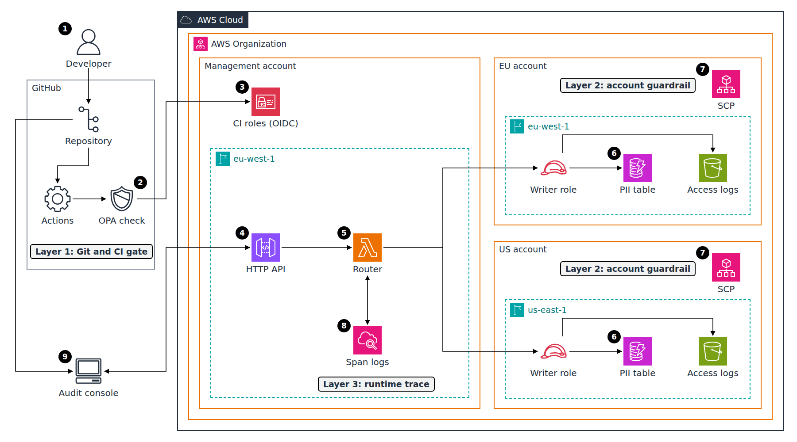
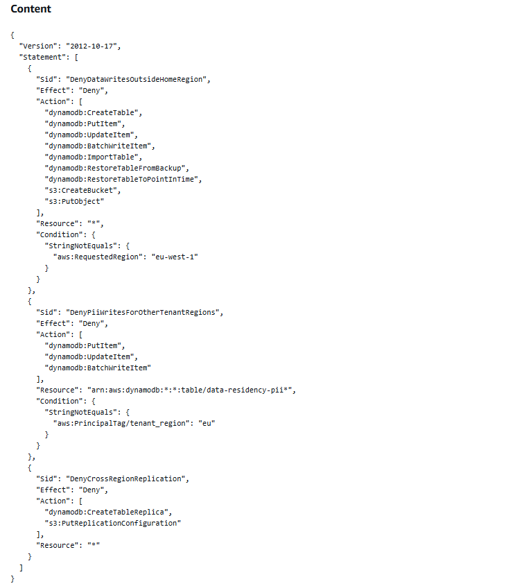
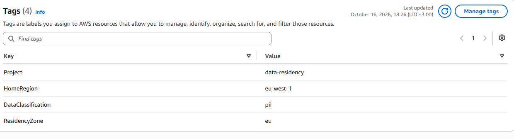
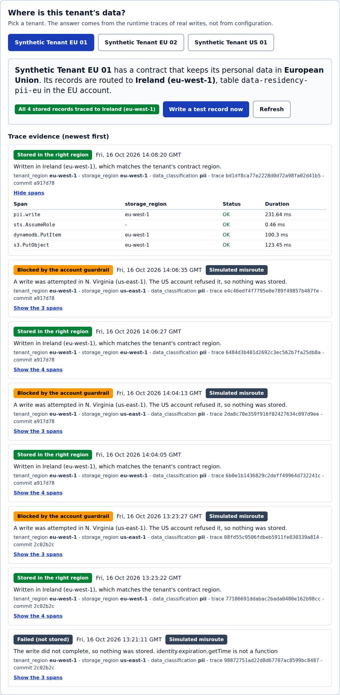
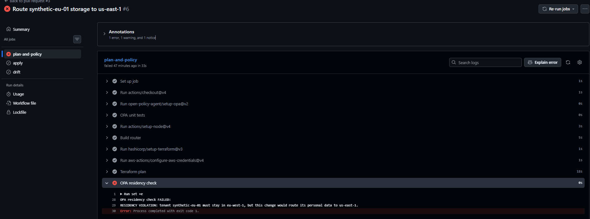
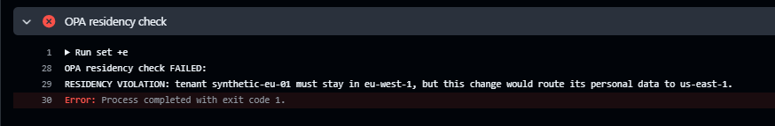
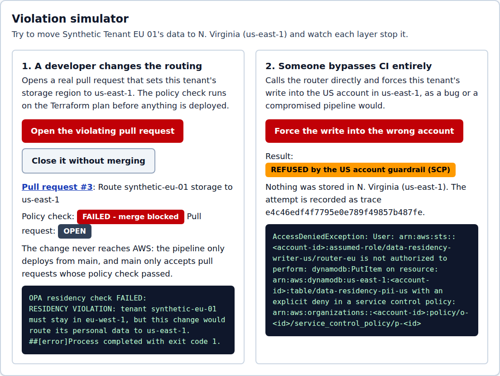
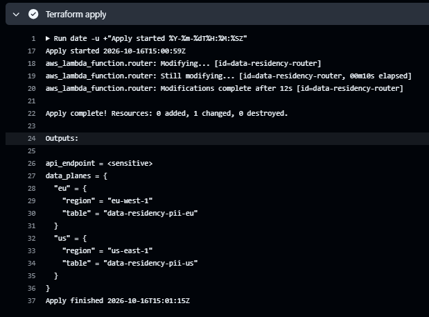
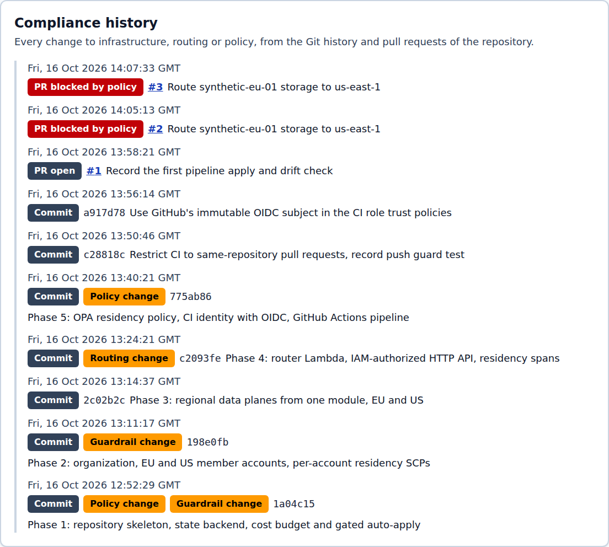

# Data Residency Proof Platform on AWS

Verifiable EU/US data residency for a multi-tenant SaaS data plane, proven by Git history, account-level guardrails and runtime traces.

## Architecture Diagram



**Flow:**

1. A developer changes the infrastructure or the tenant routing in a pull request; nothing reaches AWS without one.
2. GitHub Actions runs `terraform plan` with a read-only role and an OPA policy on the plan; a residency violation fails the required check and the merge is blocked (layer 1).
3. After a merge to `main`, the pipeline assumes the apply role through OIDC and runs `terraform apply`, the only deploy path.
4. A client calls the HTTP API in the management account (eu-west-1) with a SigV4-signed request.
5. The router Lambda looks up the tenant's contract region in the versioned registry.
6. The router assumes the writer role of that region's member account with a `tenant_region` session tag, then writes the PII item to DynamoDB and an access-log object to S3 in that region only.
7. Each member account's SCP refuses data writes outside its home region and PII writes for a tenant of the other zone, whatever the application or CI did (layer 2).
8. Every write emits OpenTelemetry spans with `tenant_region`, `data_classification` and `storage_region` into CloudWatch Logs, and the router reads them back for audits (layer 3).
9. The audit console shows, per tenant, where the data is stored from those traces, plus the compliance history from Git and pull requests.

## Table of Contents

- [The Problem This Project Solves](#the-problem-this-project-solves)
- [What This Actually Is](#what-this-actually-is)
- [Tech Stack](#tech-stack)
- [The Build, in Order](#the-build-in-order)
- [Real Problems Hit and Fixed](#real-problems-hit-and-fixed)
- [Proof It Works](#proof-it-works)
- [Cost Discipline](#cost-discipline)
- [Running This Yourself](#running-this-yourself)
- [Architecture Decisions](#architecture-decisions)
- [Cleanup](#cleanup)

## The Problem This Project Solves

After Schrems II, an EU enterprise customer buying a B2B SaaS product can ask: "prove, technically, that my customers' personal data never leaves the EEA." A policy document does not answer that. The vendor needs evidence that the routing is defined in a reviewed change, that it cannot be bypassed, and that each write actually landed where the configuration says.

## What This Actually Is

A small multi-tenant data plane split across two AWS accounts in an AWS Organization: an EU account whose data lives in eu-west-1 and a US account whose data lives in us-east-1. A router writes each tenant's records only to its assigned region. Three independent layers prove it:

- **Git and CI gate.** Every infrastructure and routing change is a pull request. An OPA rule reads the Terraform plan and fails the required check if a tenant, a PII table or a replica would leave its region.
- **Account guardrail.** One Service Control Policy per member account denies data writes outside the home region, PII writes for the other zone's tenants, and cross-region replication. It holds even if the code or the pipeline is wrong.
- **Runtime trace.** Every write carries OpenTelemetry spans with the tenant's contract region and the region the write actually went to. The audit console reads those spans back, so the answer to "where is this tenant's data" comes from what happened, not from configuration.

All tenants are synthetic (`synthetic-eu-01`, `synthetic-eu-02`, `synthetic-us-01`). The project was built as a time challenge against a 90-minute target; the real time is reported below.

## Tech Stack

| Layer | Technology |
| --- | --- |
| Infrastructure as code | Terraform 1.15 (AWS provider 6), S3 backend with native lock file |
| Accounts and guardrails | AWS Organizations, two member accounts, Service Control Policies |
| Compute and API | AWS Lambda (Node.js 22, arm64), Amazon API Gateway HTTP API with IAM authorization |
| Data, per region | Amazon DynamoDB (PII table), Amazon S3 (access logs) |
| Runtime evidence | OpenTelemetry JS SDK, spans stored in Amazon CloudWatch Logs |
| Policy as code | Open Policy Agent 1.21 (Rego v1) on the Terraform plan JSON |
| CI/CD and audit trail | GitHub Actions, OIDC federation to IAM roles, branch protection |
| Audit console | React 19, Vite 7, Tailwind CSS 4, local dev proxy with SigV4 signing |
| Tests | Bash and AWS CLI scenario scripts, OPA unit tests, Playwright headless run |

## The Build, in Order

Start 12:36 UTC. Times are wall clock and include waiting for approvals, merges and repository setup done by hand.

1. **Preflight (3 min).** Tool versions, AWS identity, AWS Organizations status (not in use yet) and account limits from the official documentation.
2. **Repository and backend (13 min).** Git identity, ignore rules, a 5 USD cost budget created before anything else, the Terraform state bucket (versioned, encrypted, TLS only, native locking), and a script that applies a saved plan automatically only when it deletes nothing, touches no account, organization or SCP, and has no undocumented IAM wildcard.
3. **Organization and SCPs (19 min, of which 6 waiting for approval).** The organization, the EU and US member accounts, and one SCP per member account, each tested with harmless calls against tables that do not exist.
4. **Regional data planes (3 min).** One Terraform module applied twice: a PII table and a log bucket in eu-west-1 for the EU account, the same in us-east-1 for the US account.
5. **Router, API and spans (10 min).** The router Lambda, the IAM-authorized HTTP API, the writer roles in each member account, and OpenTelemetry spans. CLI tests included a deliberate misroute.
6. **Policy and pipeline (35 min, of which about 5 waiting for the repository).** The OPA rule and its unit tests, the CI identity stack (OIDC provider, read-only plan role, main-only apply role), the workflow, a history audit and a pre-push guard before the first public push, then branch protection.
7. **Audit console (11 min).** Tenant evidence view, violation simulator, compliance history, and a headless end-to-end run.
8. **Waiting for merges and fixing a history leak (29 min).** Merges are done by hand in the GitHub UI; a committer e-mail written by those merges was removed from history (see below).
9. **Demo scenarios (25 min, including two merges by hand).** Latency measurement and the four scenarios.
10. **Diagram, README and console captures (29 min).** The diagram, this page, and console captures taken by hand; one needed a read-only federated sign-in to the EU account because the console session could not switch roles.
11. **Final audit and teardown (25 min).** History and image audit, then every stack destroyed in order and every account and region checked.

**Total: 3 h 22 min** (12:36:28 to 15:58:20 UTC), against a 90-minute target that was passed at 14:06 UTC, during the audit console. About 80 min of that total, estimated from the checkpoint timestamps, was waiting: approvals, the repository creation, merges done by hand in the GitHub UI, and console captures. The rest went mostly to the pipeline and its identity (35 min), the organization and SCPs (19 min), and fixing problems listed below.

## Real Problems Hit and Fixed

- **SCPs failed right after the organization was created.** `CreatePolicy` returned `AWSOrganizationsNotInUseException` about 30 seconds after `CreateOrganization` succeeded: eventual consistency. A fresh plan with only the 4 missing resources applied cleanly.
- **Every write failed with `identity.expiration.getTime is not a function`.** The router cached the assumed-role credentials with `expiration` as a number; AWS SDK v3 expects a `Date`. Fixed and redeployed; the failed writes stay in the trace history as `outcome: error`.
- **The first pipeline run could not assume its role.** GitHub issues an immutable OIDC subject for this repository that includes numeric owner and repository IDs (`repo:davidnfizionly@210562805/data-residency@1422220770:...`). The trust policies were moved to that subject, which also stops a recreated repository with the same name from assuming the roles.
- **The auto-apply gate refused a harmless trust update.** The plan JSON repeats a role's inline policies under `aws_iam_role.<name>.inline_policy`, an address that was not in the documented exceptions. The two mirror addresses were documented; the gate itself was not relaxed.
- **Organization and policy IDs visible in a console capture.** AWS denial messages carry the SCP ARN; masking covered account IDs only. Organization, root and policy IDs are now masked in the router and in the console proxy, and the capture was retaken.
- **A personal e-mail written into public history by GitHub merges.** Rebase merges and the "Update branch" button create commits on GitHub's side with the account's primary e-mail unless e-mail privacy is on. Privacy was turned on, the two commits were rewritten with the noreply address (same trees), force-pushed once with protection lifted for about a minute, and the merged branches were deleted. A read-only pull request ref kept by GitHub still points at one such commit; only GitHub Support can purge it.
- **The policy check cannot see code.** A merged router change that sent every write to us-east-1 passed OPA, because the plan only showed a Lambda code update. The US account SCP refused every EU write while it was live, and a `git revert` fixed it (scenario 4). This is why the account layer exists.
- **Smaller defects.** A reference image swept into the first commit by `git add -A` (removed before any push), history entries sorted as strings across time zones, spans reaching CloudWatch Logs a few seconds after the write, and three scenario script bugs. All are in [docs/DEVLOG.md](docs/DEVLOG.md).

## Proof It Works

The SCPs deny a write in the wrong region and a PII write without the right tenant tag, and allow the control call.

```bash
cd infra/org && ./test-scp.sh
```

Output: [proof/04-scp-deny-tests.txt](proof/04-scp-deny-tests.txt)



Each data plane exists only in its own account and region, and the SCP refuses S3 replication on the real buckets.

```bash
cd infra/stack && ./verify-placement.sh
```

Output: [proof/06-data-plane-placement.txt](proof/06-data-plane-placement.txt)



Scenario 1, audit trace: an EU write is traced to eu-west-1, tied to the deployed commit and to the commit that defined the routing, and the item exists only in the EU account.

```bash
cd infra/stack && ./scenario-audit-trace.sh synthetic-eu-01
```

Output: [proof/13-scenario1-audit-trace.txt](proof/13-scenario1-audit-trace.txt)



Scenario 2, blocked violation in CI: a pull request that routes `synthetic-eu-01` to us-east-1 fails the required OPA check and cannot be merged.

```bash
gh pr view 3 --json state,statusCheckRollup
```

Output: [proof/16-scenario2-blocked-pr.txt](proof/16-scenario2-blocked-pr.txt)





Scenario 3, hard block at the account level: CI is bypassed with a direct invocation that forces each tenant into the other account; both destination SCPs refuse and nothing is stored.

```bash
cd infra/stack && ./scenario-scp-block.sh
```

Output: [proof/15-scenario3-scp-hard-block.txt](proof/15-scenario3-scp-hard-block.txt)



Scenario 4, compliant rollback: a merged code change that routed every write to us-east-1 was contained by the US account SCP (every EU write refused), then reverted with `git revert` and a merge. Measured once: 50 s from the merge to the end of `terraform apply`, 51 s from the merge to the first EU write stored in eu-west-1 (writes every 5.5 s, so about 6 s of resolution).

```bash
cd infra/stack && ./scenario-rollback-watch.sh
```

Output: [proof/17-scenario4-bad-change-live.txt](proof/17-scenario4-bad-change-live.txt), [proof/18-scenario4-rollback-timing.txt](proof/18-scenario4-rollback-timing.txt)



The compliance history lists every change and every blocked pull request.



Latency of `POST /records`, measured right after a deploy (10 concurrent requests on fresh environments, then 30 sequential), in milliseconds. Client latency is end to end from a test machine in East Africa to eu-west-1, signed request included; Lambda figures come from the REPORT lines.

| Measure | n | min | median | max |
| --- | --- | --- | --- | --- |
| Cold, client latency | 10 | 2079 | 2463 | 2517 |
| Cold, Lambda Init Duration | 10 | 327 | 447 | 462 |
| Cold, Lambda Duration (first AssumeRole included) | 10 | 869 | 1138 | 1187 |
| Warm, client latency | 30 | 735 | 783 | 965 |
| Warm, Lambda Duration (cached writer credentials) | 30 | 130 | 169 | 347 |

```bash
cd infra/stack && ./measure-latency.sh
```

Output: [proof/14-latency-cold-warm.txt](proof/14-latency-cold-warm.txt). Automated captures come from a headless Chromium run of the console (`console/e2e/flow.mjs`).

## Cost Discipline

- A 5 USD monthly cost budget (credits and refunds excluded) was created before any other resource. It has **no alert configured**: it tracks spend only, and spend is checked by hand in Budgets and Cost Explorer, which lag up to 24 hours.
- Pay-per-use only: Lambda, HTTP API, on-demand DynamoDB, S3, CloudWatch Logs with 7-day retention. No NAT Gateway, no EC2, no provisioned database, no always-on resource.
- Organizations, the accounts and the SCPs have no charge.
- The budget was deleted with the rest of the backend at teardown. Cost Explorer lags up to 24 hours, so no final cost figure is stated here.

## Running This Yourself

Prerequisites: an AWS account that is not yet in an organization, the AWS CLI with an administrator profile, Terraform 1.15, Node.js 22 or later, `gh`, `jq`, OPA 1.21. Every stack reads the state bucket from an ignored `infra/state.tfbackend` file and its account IDs from ignored `*.auto.tfvars` files.

```bash
# 1. Backend: applied once with local state, then migrated into the bucket it creates
cd infra/backend && terraform init && terraform apply
printf 'bucket = "%s"\nregion = "us-east-1"\nencrypt = true\nuse_lockfile = true\n' \
  "$(terraform output -raw state_bucket)" > ../state.tfbackend
terraform init -migrate-state -force-copy -backend-config=../state.tfbackend

# 2. Organization, member accounts, SCPs (org.auto.tfvars holds the two member e-mails)
cd ../org && terraform init -backend-config=../state.tfbackend && terraform apply
./test-scp.sh

# 3. Data planes, router, API (stack.auto.tfvars holds the member account IDs)
cd ../../lambdas/router && npm ci && npm run build
cd ../../infra && ./scripts/safe-apply.sh stack -var "git_commit=$(git rev-parse HEAD)"
cd stack && ./test-router.sh

# 4. CI identity (applied by hand, never by the pipeline)
cd .. && ./scripts/safe-apply.sh ci
gh secret set AWS_PLAN_ROLE_ARN    # and AWS_APPLY_ROLE_ARN, TF_STATE_BUCKET, MEMBER_ACCOUNT_IDS

# 5. Policy tests
opa test policy/ -v

# 6. Audit console
cd console && npm ci && npm run dev    # http://127.0.0.1:5173
```

`safe-apply.sh` applies without a manual approval only when the plan passes the auto-apply rule described below; any other plan stops for a manual `terraform apply`. On a first deploy the writer and CI policies reference resources that do not exist yet, so that first apply is approved by hand.

## Architecture Decisions

**Mono-cloud multi-region over multi-cloud.** The audit question is about a region boundary, not a vendor boundary; a second cloud adds cost and build time without adding evidence.

**GitHub Actions over Argo CD.** Argo CD syncs Git to Kubernetes and there is no Kubernetes here. A pipeline with a required check and a main-only apply gives the same reviewed, auditable path.

**SCPs in addition to the CI policy check.** CI assumes CI was not bypassed. The SCP holds even when the code is wrong, as scenario 4 showed: the OPA check passed a code change that the SCP then refused at runtime.

**OPA over cfn-nag and conftest.** cfn-nag lints CloudFormation, not Terraform plans; conftest wraps OPA without adding a check.

**Two accounts over a landing zone.** Two member accounts and one SCP each are the minimum that proves the boundary; account vending and centralized logging are a different project.

**Router in eu-west-1 over us-east-1.** The router handles request bodies, so it runs in the EEA: EU data never transits a US region.

**A versioned registry file over a runtime registry table.** Routing changes are commits, visible in the Terraform plan that the policy reads; a table edited at runtime would skip review.

**Session tags over a separate role per tenant.** The router passes the tenant's zone as `tenant_region` when it assumes the writer role, and the SCP compares it with the account's zone, so a misrouted write is refused even with valid credentials.

**IAM-authorized HTTP API over an API key.** There is no shared secret to leak; the console's local proxy signs requests, so no credential reaches the browser.

**CloudWatch Logs as the span store over X-Ray or a collector.** The spans are JSON lines in the Lambda log group, read back with a filter pattern; no extra service is needed for the same evidence.

**Separate plan and apply roles over one CI role.** Pull requests can only assume the read-only plan role, so even a pull request that edits the workflow cannot apply. Fork pull requests get no OIDC token, no secrets, and the plan job skips them.

**S3 native state locking over a DynamoDB lock table.** Terraform 1.10 and later lock with a file in the state bucket; the lock table is deprecated for the S3 backend.

**Gated auto-apply over approving every plan by hand.** A script reads the saved Terraform plan as JSON and applies it without a manual approval only if nothing is deleted, no account, organization or SCP is touched, and no IAM permission uses a generic action or resource that is not documented in `docs/DECISIONS.md`. Any other plan waits for a manual approval. The rule is in ADR-005.

All decisions, including the ones not listed here, are in [docs/DECISIONS.md](docs/DECISIONS.md).

## Cleanup

Teardown on 2026-10-16, each step approved by hand, in this order:

1. The pipeline workflow was disabled after the last apply run finished, so the daily drift check could not fail against deleted resources and no merge could redeploy.
2. `infra/stack`: 27 resources destroyed (API, router, log group, tables, buckets, writer roles).
3. `infra/ci`: 13 resources destroyed (OIDC provider, CI roles in all three accounts).
4. `infra/org`: the two SCP attachments and policies destroyed. The organization and the two member accounts are kept, empty, with only the default `FullAWSAccess` SCP; they have no charge. Their Terraform state was moved to a local file first.
5. `infra/backend`: the state bucket emptied (68 object versions, 47 delete markers) and destroyed with the budget, 7 resources.

```bash
terraform -chdir=infra/stack destroy
terraform -chdir=infra/ci destroy
terraform -chdir=infra/org destroy -target=aws_organizations_policy_attachment.residency -target=aws_organizations_policy.residency
terraform -chdir=infra/backend destroy    # after moving its state to a local backend and emptying the bucket
aws resourcegroupstaggingapi get-resources --tag-filters Key=Project,Values=data-residency
```

The final check found, in every account and in both regions, no Lambda function, HTTP API, DynamoDB table, log group, bucket, IAM role or OIDC provider from the project; the only tagged resources left are the two member accounts.

Output: [proof/19-destroy-stack.txt](proof/19-destroy-stack.txt), [proof/20-destroy-ci.txt](proof/20-destroy-ci.txt), [proof/21-post-destroy-check.txt](proof/21-post-destroy-check.txt), [proof/22-final-cleanup-check.txt](proof/22-final-cleanup-check.txt)
